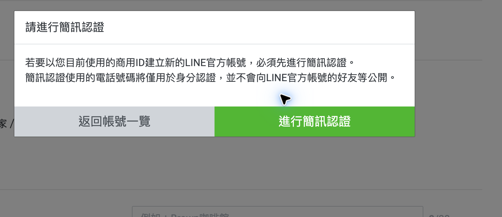
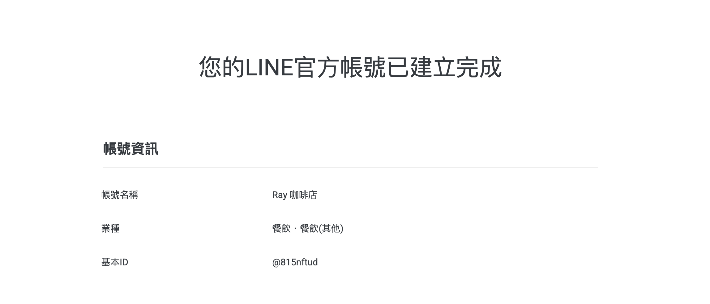
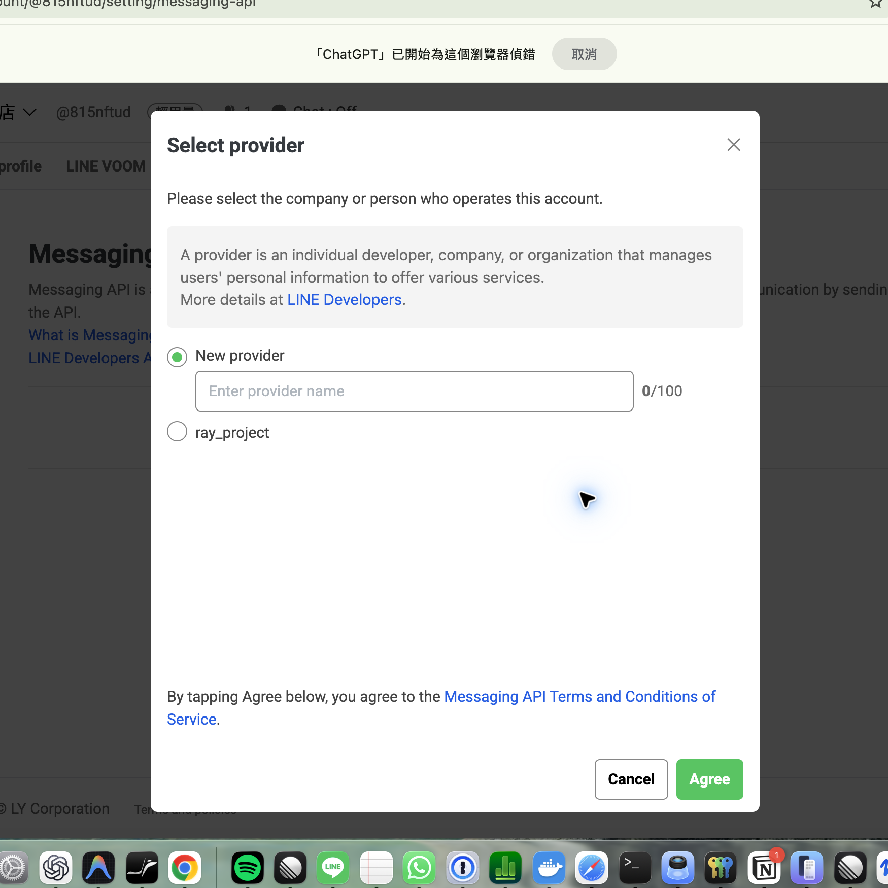
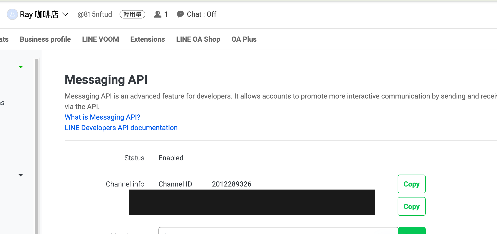
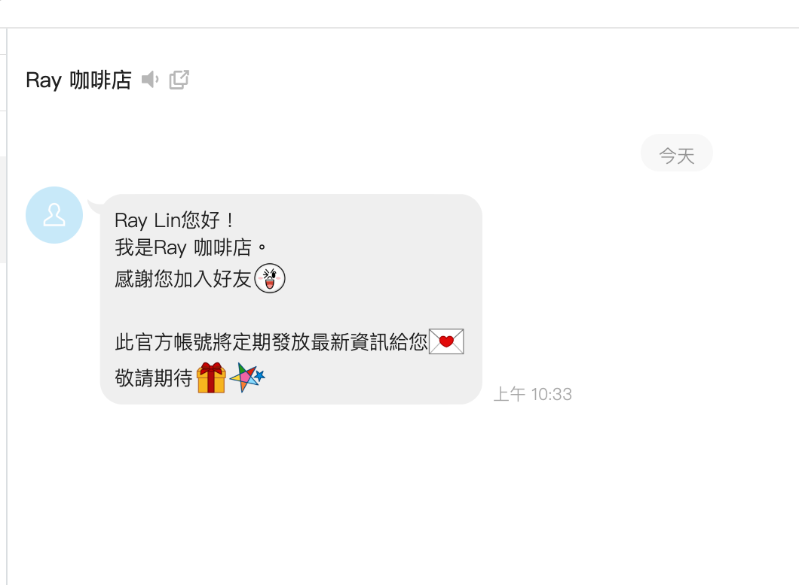
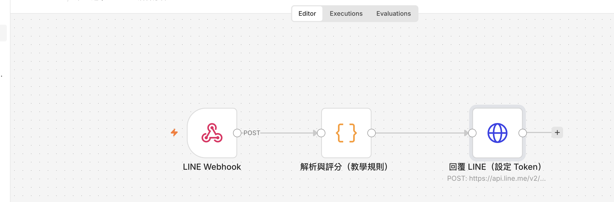
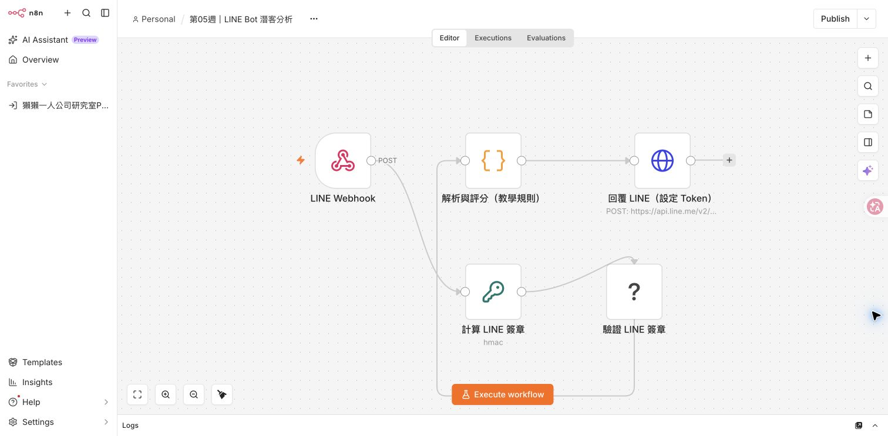
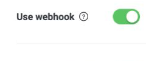
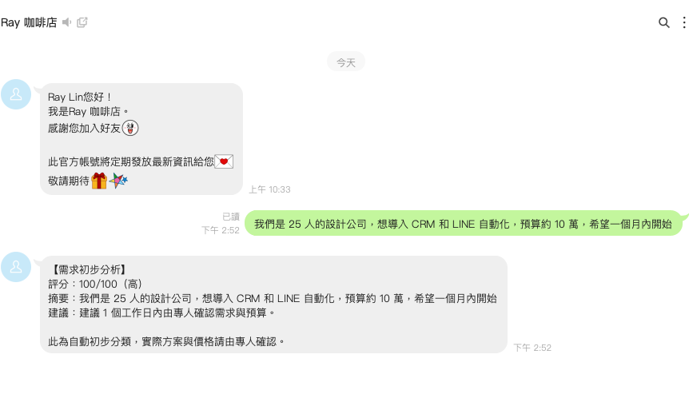

# LINE Bot 潛客分析：從官方帳號到 n8n

本教材參考 [n8n + LINE Bot 完整串接教學](https://n8nstart.cc/blog/n8n-line-bot-ai-customer-service/)，延伸第五週 Telegram 潛客評分單元。範例收到 LINE 使用者的文字需求後，解析來源與訊息、以可解釋的規則產生示範分數，並透過 LINE Reply API 回覆評估與下一步。工作流不會把資料寫入外部名單，也不會自動聯絡業務人員。

> 此為教學原型。示範評分採規則式，不是 AI 模型推論；可在課堂上接 OpenAI 節點進行語意分類。收到使用者資料前，請先告知用途並取得必要同意。

## 學習成果

- 從 LINE 官方帳號管理後台啟用 Messaging API，並確認自動建立的 Channel。
- 使用自己既有的 LINE 個人帳號加入測試官方帳號好友；不必另辦個人 LINE。
- 讓 n8n 透過 HTTPS Webhook 接收 LINE 事件。
- 解析文字、replyToken、userId，排除非文字與非訊息事件。
- 對需求進行示範式潛客評估，並在 LINE 回覆結果。
- 能辨識憑證保護、replyToken 時效及 Webhook 驗證等限制。

## 事前準備

- LINE 帳號、可管理 LINE Official Account 的權限。
- 電腦已安裝並能開啟 n8n（`http://localhost:5678`）。稍後會用 Cloudflare Quick Tunnel 提供 LINE 能連線的臨時 HTTPS 網址；LINE 伺服器不能直接連學生電腦的 localhost。
- 本資料夾的 `課堂練習/LINE Bot 潛客分析.json`。
- 選用：OpenAI API Key（本範例不需要）。

## 一、建立 LINE 官方帳號與 Messaging API

### 課堂操作原則：每位學生建立自己的測試帳號

純課堂測試不必另辦一個新的個人 LINE 帳號。學生可用自己有權管理的 LINE／Business ID，在 [LINE Official Account Manager](https://manager.line.biz/) 新增一個**獨立的測試用官方帳號**。每位學生各自建立、各自保管 Channel 憑證；不要共用其他人的既有官方帳號，也不要把真實客服帳號接到課堂工作流。

先分清兩個名稱：**官方帳號**是好友看到並加入的帳號；**Messaging API Channel**是 n8n 呼叫 LINE 服務用的連線設定。LINE 現在要求先建立官方帳號，再到 Official Account Manager 啟用 Messaging API，Channel 會自動建立在選定的 Provider 底下。

1. 登入 [LINE Official Account Manager](https://manager.line.biz/)，左側選 **Create new／建立新帳號**。
2. 填寫必填的帳號名稱、電子郵件與公司所在國家／地區。課堂示例名稱可用「n8n 課堂測試」；公司名稱與業種若要填寫，請使用本人或組織的真實資料，不要編造或代填別人的資料。
3. 閱讀 LINE 官方帳號服務條款及隱私權政策。按下表單的 **確定** 會送出申請資料；請先核對資料，並由帳號申請者本人確認同意條款。
4. LINE 可能要求簡訊認證。電話號碼只用於身分認證、不會顯示給好友；由你本人輸入電話與簡訊驗證碼完成認證。

   
5. 建立完成後，會看到官方帳號建立成功畫面。下圖是操作示意，帳號名稱、業種與基本 ID 只是範例，請使用你自己的資料。

   

   接著進入新測試帳號的 **設定 → Messaging API**，按 **Enable Messaging API**。LINE 會開啟 **Select provider** 視窗。先不要急著按 Agree；Provider 是選擇 Messaging API Channel 的管理者／所屬單位。
6. 在 **Select provider** 視窗選 Provider：
   - **Provider** 是管理 Messaging API Channel 的個人、公司或組織；不是官方帳號名稱、個人 LINE 名稱或密鑰。Channel 建立後會歸在此 Provider 底下。
   - 個人管理自己的課堂帳號：選 **New provider** 左側圓鈕，在 **Enter provider name** 輸入「你的姓名－n8n課堂測試」，例如 `王小明－n8n課堂測試`。把範例姓名換成自己實際負責管理的姓名；不要填官方帳號名稱、email、電話或任何 Token／secret。
   - 若課程由學校／公司管理，只有在該組織確實負責此帳號並授權你使用時，才填組織名稱或選它的既有 Provider。選既有項目須有該 Provider 的 **Admin** 權限；不要因為名稱出現在清單就任意選。
   - 不確定帳號屬於誰，先關閉視窗並詢問帳號管理者，不要按 **Agree**。確認圓鈕選到正確項目後再按 **Agree**。Provider 一旦連結就不能移除或更換。

   下圖的 `ray_project` 是畫面範例，不是要學生照抄或直接選的名稱。

   
7. 等待啟用完成，開啟 [LINE Developers Console](https://developers.line.biz/console/)，從左側點選剛才的 Provider。應能看到新建的 Messaging API Channel；若找不到，先確認登入的是同一個 LINE／Business ID，且 Provider 名稱正確。
8. 在 Channel 的 **Basic settings** 查看 **Channel secret**；再切到 **Messaging API** 頁籤，找到 **Channel access token (long-lived)**，點 **Issue** 核發。Token 和 secret 是不同用途的兩把密鑰：secret 驗證 LINE 傳入的 webhook；access token 讓 n8n 呼叫 LINE API 回覆訊息。兩者都只放在指定的 n8n Credential／密碼管理工具，不要貼到教材、工作流 JSON、截圖、聊天或 Git。若外洩，依官方流程輪替或撤銷。

   
9. 找到 Messaging API 頁籤中的官方帳號 QR Code，或從 Official Account Manager 複製好友加入連結。下一小節會用它把你原有的 LINE 個人帳號加為好友；不用另辦個人 LINE。

建立成功畫面會顯示帳號名稱、業種與基本 ID。基本 ID 是好友搜尋用識別碼，不是密鑰。

**完成檢查：**你已能在 Developers Console 的正確 Provider 下看到新 Channel，並找到自己的 Channel secret、核發 access token、取得好友 QR Code。

### 用既有 LINE 個人帳號加入測試官方帳號

1. 在 Developers Console 的 **Messaging API** 頁籤找到 QR Code；也可在 Official Account Manager 找到好友加入連結。
2. 用手機開啟 LINE，點 **主頁 → 右上角新增好友 → 行動條碼**，掃描 QR Code。也可以用手機相機掃描後選擇以 LINE 開啟。
3. 在官方帳號頁面點 **加入好友**。完成後會看到你建立的官方帳號對話視窗。
4. 如果先收到歡迎訊息，代表你的個人 LINE 已成功加入官方帳號；這只是 LINE 官方帳號的好友歡迎訊息，不代表 n8n Webhook 已收到事件或潛客工作流已回覆。
5. 使用自己現有的 LINE 個人帳號即可，無需另外註冊新的 LINE 個人帳號。

   

### 首次進入管理後台：帳號資訊使用同意

首次進入 Official Account Manager 時，可能會看到 LY Corporation 的帳號資訊使用同意頁。請閱讀頁面上的資料類型、用途、分享對象及隱私權政策，由帳號所有人或獲授權管理者自行決定是否同意；不清楚內容時先不要繼續。

## 二、匯入工作流並設定 Token

1. 在 n8n 左側選 **Workflows**，點 **Import from File**，選取本教材資料夾中的 `課堂練習/LINE Bot 潛客分析.json`，等待工作流畫布載入。匯入只會載入節點設定，不會自動帶入你的 LINE 憑證。
2. 在畫布點「回覆 LINE（設定 Token）」節點。在右側設定面板找到 **Authentication**，選 **Generic Credential Type**；接著在 **Generic Auth Type** 選 **Header Auth**。在 **Credential to connect with** 旁點 **Create new credential**（若版本顯示加號或 **Create new**，點該按鈕）。
3. 在 Credential 編輯表單填入：Credential 名稱 `LINE Reply Credential`（只是 n8n 裡的標籤）；**Name** 填 `Authorization`；**Value** 填 `Bearer `，後面緊接你剛核發的 long-lived Channel access token。Header Auth 會把 Token 放進呼叫 LINE API 的授權標頭。`Bearer` 後面要有一個空格，請勿加引號。若表單有 **Allowed HTTP Request Domains**，只允許 `api.line.me`。確認沒有多貼空格或換行後按 **Save**。這個憑證只存於你的 n8n，不要放在工作流一般文字欄位、教材、截圖或聊天。
4. 儲存 Credential 後，確認它已在節點的 **Credential to connect with** 欄位被選取。若沒有，打開下拉選單點選 `LINE Reply Credential`。節點若另有 **Headers** 區塊，刪除其中任何明文或佔位的 Authorization header；保留 `Content-Type: application/json`。不要同時用 Credential 和手動 Authorization header。
5. 儲存工作流。Webhook Production URL 會是 `http://localhost:5678/webhook/line-lead-analysis`；本機 n8n 顯示 localhost 很正常。使用 Quick Tunnel 時，將網域部分換成當次隨機 HTTPS 網址，保留 `/webhook/line-lead-analysis` 路徑。Quick Tunnel 的安裝與啟動步驟見第三節；LINE Webhook URL 的設定見第四節。

   

> **完成檢查：**回覆節點已選取 Header Auth Credential，工作流已儲存。正式 Webhook 要等發布後才會啟用；分享 JSON 前確認沒有明文 Token 或 Channel secret。

## 三、讓 LINE 從網路連到本機：Cloudflare Quick Tunnel

### Tunnel 是什麼？

`localhost` 只代表目前這台電腦。LINE 的伺服器在網際網路上，不能直接連到學生電腦的 `http://localhost:5678`。Cloudflare Tunnel 是在本機執行的小程式 `cloudflared`：它從電腦向 Cloudflare 建立連線，再把外部送到臨時 HTTPS 網址的請求轉送回本機 n8n。學生不必設定路由器或購買網域。

本課使用 **Quick Tunnel（快速通道）**：不需 Cloudflare 帳號或自有網域，啟動後會產生隨機的 `https://xxxx.trycloudflare.com` 網址。通道只在 `cloudflared` 執行期間有效，停止後失效，重開會換新網址。這是臨時公開入口；持有網址的人可能連到你的 n8n 服務，請勿用於正式客服或長期營運。[Cloudflare Quick Tunnels 官方說明](https://developers.cloudflare.com/tunnel/get-started/quick-tunnels/)

### A. 安裝 cloudflared（每位學生只需做一次）

先確認 n8n 已啟動，而且在自己的電腦開啟 `http://localhost:5678` 能看到登入頁或工作區。若一開網址就能直接進入工作區，先替 n8n 設定登入保護，再繼續。

**macOS（有 Homebrew）：**開啟「終端機」輸入：

```bash
brew install cloudflared
cloudflared --version
```

若尚未安裝 Homebrew，可到 [Cloudflare 官方下載頁](https://developers.cloudflare.com/tunnel/downloads/) 選擇 macOS 版本（Apple Silicon 選 arm64；Intel Mac 選 amd64），依頁面步驟安裝。

**Windows：**到 [Cloudflare 官方下載頁](https://developers.cloudflare.com/tunnel/downloads/)下載 Windows 64-bit MSI 安裝檔並安裝。開啟 PowerShell，輸入：

```powershell
cloudflared --version
```

若系統顯示找不到指令，關閉並重新開啟終端機；仍無法使用時，確認安裝完成，或依 Cloudflare 下載頁的 Windows 手動安裝步驟操作。Linux 學生請依該頁面選擇自己的發行版。

### B. 啟動臨時 HTTPS 通道（每次測試都要做）

1. 保持 n8n 開啟，另外開一個新的終端機／PowerShell 視窗。通道運作期間，這個視窗必須保持開啟。
2. 輸入以下命令，讓外部 HTTPS 請求轉送到本機 n8n 的 5678 埠。macOS、Linux 終端機及 Windows PowerShell 都使用同一行命令：

   ```bash
   cloudflared tunnel --url http://localhost:5678
   ```

3. 等待終端機顯示 `Your quick Tunnel has been created!`，複製下一行的 `https://...trycloudflare.com` 網址。不要照抄範例網址，每位學生每次產生的網址都不同。
4. 在瀏覽器開啟該 HTTPS 網址。若出現自己的 n8n 登入頁，表示通道已連到本機服務。LINE Webhook 使用此網址加上 n8n Webhook Production URL 的路徑，例如：

   ```text
   https://隨機名稱.trycloudflare.com/webhook/line-lead-analysis
   ```

5. 把完整 Webhook 網址貼到 LINE Developers Console 的步驟見第四節 4.1。不要只貼網域；網址必須包含 `/webhook/line-lead-analysis`。先保持 LINE 的 **Use webhook** 關閉，等完成簽章設定再測試。

**完成檢查：**終端機仍在執行，且你已複製當次的 Quick Tunnel 網址。

### 電腦重新啟動後怎麼恢復

重新啟動電腦會結束本機執行中的 `cloudflared`；n8n 是否同時停止，取決於你使用 Docker、桌面服務或其他方式啟動。恢復時依序確認：

1. 開啟 n8n（例如啟動 Docker Desktop 並啟動 n8n 容器），在瀏覽器確認 `http://localhost:5678` 可以開啟。
2. 確認「第05週｜LINE Bot 潛客分析」工作流仍是 **Published／Active**，兩處 LINE Webhooks／Use webhook 都是開啟狀態。
3. 打開終端機，重新執行 `cloudflared tunnel --url http://localhost:5678`。保持終端機開著，等它顯示新的 `https://……trycloudflare.com` 網址。
4. 將新網址接上 `/webhook/line-lead-analysis`，到 LINE Developers Console → **Messaging API → Webhook settings → Edit** 更新完整 Webhook URL，按 **Update**，再按 **Verify** 確認成功。Quick Tunnel 重開後通常會換網址；舊網址不再連到這次的新隧道。
5. 在手機傳一則測試文字，確認 n8n **Executions** 有新的成功執行，LINE 也收到回覆。若上次已依第六節關閉服務，請依第四節 4.4 重新發布並開啟兩處 Webhook。

**重開電腦或重跑 `cloudflared` 不會改變 n8n Credential。**重跑 Tunnel 只會換公開網址；回 LINE 更新 Webhook URL 即可。只有 LINE 重新核發／撤銷 Token 或 Channel secret 時，才需將新值更新到對應的 n8n Credential。

### C. 安全使用

- 隧道期間公開的是整個 n8n 網址，不只 Webhook。若 `localhost:5678` 不需登入就能進工作區，先依 [n8n 使用者管理說明](https://docs.n8n.io/user-management/) 設定登入保護，再開 Tunnel。不要分享隨機網址。
- 每位學生只連自己的 n8n 和測試官方帳號，不共用 Token，也不連真實客服帳號。
- 所有練習完成後依第六節關閉 Webhook、取消發布並停止 Tunnel。Quick Tunnel 僅供臨時教學，不適合正式部署；詳見 [Cloudflare 官方說明](https://developers.cloudflare.com/tunnel/get-started/quick-tunnels/)。


## 四、設定 LINE Webhook

請照順序完成；不要跳過簽章與憑證設定。

### 4.1 設定 LINE Webhook URL

1. 確認 n8n 已開啟、工作流已儲存，而且 `cloudflared` 終端機仍在執行。
2. n8n 開啟「LINE Webhook」節點，點 **Production URL**。畫面會顯示類似 `http://localhost:5678/webhook/line-lead-analysis` 的 URL。複製路徑 `/webhook/line-lead-analysis`；不要把 localhost 貼給 LINE。
3. 把這個路徑接在本次 Quick Tunnel 網域後面，形成完整的 `https://隨機名稱.trycloudflare.com/webhook/line-lead-analysis`。不可多打一個 `/`、不可漏掉 `/webhook/`，每次重啟通道後必須重新確認網址。
4. 開啟 [LINE Developers Console](https://developers.line.biz/console/) → 左側選你剛設定的 Provider → 點你建立的官方帳號 Channel → **Messaging API** → 向下找到 **Webhook settings**。
5. 點 Webhook URL 旁的 **Edit**，貼入完整 HTTPS URL，再按 **Update**。回到欄位確認已顯示新網址。此時先不要按 Verify、也不要打開 Use webhook，先完成下面的簽章設定。

### 4.2 準備簽章驗證 Credential

Webhook 簽章用來確認請求確實由 LINE 平台發出。LINE 以原始 HTTP body 和 Channel secret 計算 HMAC-SHA256，並將結果放在 `x-line-signature` 標頭。內容必須在驗簽前保持原樣，不能先把 JSON 重新排版或改寫。[LINE 官方簽章驗證說明](https://developers.line.biz/en/docs/messaging-api/verify-webhook-signature/)

**每位學生使用自己官方測試帳號的 Channel secret：**

1. 在 LINE Developers Console 的 Channel 頁面切到 **Basic settings**，找到 **Channel secret**。新建課堂 Channel 使用 LINE 顯示的 secret 即可。只有在 secret 曾外洩或需要撤換時才按 **Issue**；核發新 secret 會讓舊值立即失效，所有使用舊值的服務都必須更新。[LINE 簽章驗證說明](https://developers.line.biz/en/docs/messaging-api/verify-webhook-signature/)。每位學生都使用自己 Channel 顯示的 secret。
2. 在 n8n 左側選 **Overview**，再選分頁 **Credentials**，點 **Create credential**。在搜尋框輸入 `Crypto`，選結果 **Crypto**，按 **Continue**。
3. 在憑證編輯視窗最上方將名稱設為 `LINE Webhook 簽章驗證`（若名稱欄不在目前頁面，先儲存為 `LINE 簽章 Credential`，再從 Credentials 清單開啟該 Credential 改名）。只在 **Hmac Secret** 欄位輸入 Channel secret；Private Key、Encryption Passphrase、Encryption Public Key、Encryption Private Key 都留空。檢查值沒有多餘空白，再按 **Save**。Credential 欄位會遮蔽內容；不需將 secret 貼到任何工作流欄位。
4. 回到工作流，點「計算 LINE 簽章」節點。在 **Credential to connect with** 下拉選擇剛建立的 Crypto Credential。檢查 **Action = Hmac**、**Binary File = On**、**Binary Property Name = data**、**Type = SHA256**、**Property Name = expectedSignature**、**Encoding = BASE64**。如果介面提示缺少 Credential，按 **Create new credential** 建立後再回此節點選取。
5. 點「LINE Webhook」節點，確認 **HTTP Method = POST**、**Path = line-lead-analysis**。打開 **Options**，新增／開啟 **Raw Body**。在 **Respond** 或 **Response Mode** 選 **Immediately / On Received**，讓 LINE Verify 請求快速得到成功 HTTP 回應。
6. 點「驗證 LINE 簽章」IF 節點，條件類型設 **String**，操作設 **Equals**。左欄切到 **Expression** 並填 `{{ $json.expectedSignature }}`；右欄切到 **Expression** 並填 `{{ $('LINE Webhook').first().json.headers['x-line-signature'] }}`。確認連線只由 IF 的 **true** 輸出接到「解析與評分」；false 輸出保持未連線，使簽章錯誤的請求不會被評分或回覆。
7. 回到「回覆 LINE（設定 Token）」節點，確認已選取第二節建立的 `LINE Reply Credential`，且允許網域（若有此欄位）只限 `api.line.me`。範例 JSON 不含任何人的實際憑證。


### 4.3 設定並閱讀 n8n 驗簽節點

工作流畫面應有下列節點與連線；簽章失敗的事件不會流入評分和 LINE Reply API。



| 順序 | 節點 | 設定／用途 |
|---|---|---|
| 1 | LINE Webhook | Method `POST`；Path `line-lead-analysis`；Options 開啟 **Raw Body**；Response 設 **Immediately / On Received**。Raw Body 讓 n8n 保留原始位元組，以免解析 JSON 後改變簽章輸入。 |
| 2 | 計算 LINE 簽章 | Crypto → Hmac；讀取 Webhook 輸出的 binary `data`；SHA256；BASE64；Credential 使用你自己的 Channel secret。輸出欄位 `expectedSignature`。 |
| 3 | 驗證 LINE 簽章 | IF 節點以字串 Equals 比較左值 `={{ $json.expectedSignature }}` 和右值 `={{ $('LINE Webhook').first().json.headers['x-line-signature'] }}`。大小寫需一致，不能 trim、轉碼或重建 body。 |
| 4 | 解析與評分（教學規則） | 只接 IF 的 **true** 輸出。只處理文字訊息，計算分數與下一步建議；圖片、貼圖、加入好友等事件不會被當成潛客文字。 |
| 5 | 回覆 LINE（設定 Token） | 只接評分節點；使用 Header Auth Credential 呼叫 Reply API。簽章錯誤時 IF false 分支沒有後續節點，因此事件不會被評分或回覆。 |

在 Webhook node 的 **Raw Body** 未打開，或 Crypto node 設成文字而不是 binary 時，算出的 HMAC 會和 LINE 簽章不一致。LINE 明確要求驗證原始 body，不可先解析／美化 JSON 再計算。

### 4.4 先測試簽章，再發布工作流

> **要讓 LINE Bot 持續接收訊息，以下條件必須同時成立：**n8n 工作流已 **Published／Active**、n8n 服務持續執行、Cloudflare Tunnel 持續執行且 LINE Developers Console 裡的 Webhook URL 指向目前有效的 HTTPS 網址，以及 LINE Developers Console 的 **Use webhook** 與 Official Account Manager 的 **Webhooks** 都已開啟。只發布工作流不會替已停止的 n8n 或 Tunnel 開機；在編輯器按 **Execute workflow** 也不會持續監聽 LINE。

1. LINE Developers Console 已登入且位於正確 Channel；在 n8n 確認 Crypto Credential 的 Hmac Secret 是本 Channel 當前有效的值，不要把值複製到截圖。
2. 在 n8n 工作流頁按 **Save**，再點右上角 **Publish**。在確認視窗檢查名稱「第05週｜LINE Bot 潛客分析」後發布。這時 LINE 的 Use webhook 仍可維持關閉。
3. 回 LINE Developers Console → **Messaging API → Webhook settings**，按 **Verify**。LINE 會送出測試事件；成功時頁面顯示 Success。由於測試事件的 `events` 陣列是空的，預期不會收到潛客評分回覆。
4. 若 Verify 失敗，先看 n8n 左側 **Executions**，打開最新執行，逐一看「計算 LINE 簽章」和「驗證 LINE 簽章」輸入/輸出，不要查看或複製 credential 值。再依故障排除表核對 raw body、Credential、Channel 和簽章 header。
5. Verify 成功後，在相同頁面打開 **Use webhook**。再到 [Official Account Manager](https://manager.line.biz/) → 選自己的官方帳號 → **設定 → 回應設定**，開啟 **Webhooks**。

   

6. 在 Official Account Manager 的 **設定 → 回應設定**，把 **Greeting message** 和 **Auto-response messages** 設為 **Disabled／停用**，並確認 **Webhooks** 為啟用。新官方帳號常會預設發送歡迎或自動回覆；先停用可避免和 n8n 回覆重複。已送出的歡迎訊息不會撤回。[LINE 官方說明](https://developers.line.biz/en/docs/messaging-api/building-bot/)
7. 用手機對話送出合成測試訊息：`我們是 25 人的設計公司，想導入 CRM 和 LINE 自動化，預算約 10 萬，希望一個月內開始。` 不要使用真實客戶個資。依範例規則，此訊息預期為 **100/100（高）**。
8. 在 n8n 工作流的 **Executions** 開啟最新 production execution，確認 LINE Webhook、簽章計算、簽章比對、解析評分、LINE Reply API 五個節點成功；再確認手機收到分析回覆。LINE 的 Verify 測試事件為空，不會產生潛客評分回覆。接著做第五節的評分練習，完成後再依第六節關閉服務。

**持續接收檢查：**成功收到測試回覆後，保持 n8n 和 `cloudflared` 執行，再從 LINE 傳送另一則合成訊息。確認 **Executions** 新增成功紀錄且手機收到回覆，代表目前的接收設定有效。若停止 Tunnel、n8n 或電腦，LINE 就無法送入本機；Quick Tunnel 重開會換網址，須更新 LINE Webhook URL 並重新 Verify，再確認工作流仍已發布及兩處 Webhooks 開啟。若切換到另一個 LINE 工作流，先停用原工作流，將 LINE Webhook URL 改為新流程的路徑，再發布並測試新流程。

## 五、理解評分並練習

這是可解釋的**關鍵字規則範例**，不是 AI 判斷，也不是正式業務資格評分。每一類條件最多加一次，總分最高 100：

| 訊息符合條件 | 加分 |
|---|---:|
| 起始分 | 20 |
| 文字長度至少 20 字 | +15 |
| 提到「預算」、「萬／萬元」、貨幣符號或 4 位以上數字 | +25 |
| 提到本週、盡快、一個月等時程 | +20 |
| 提到「想」、「希望」、「導入」、「自動化」、「CRM」等字詞 | +20 |

分數 **75 以上＝高**、**50–74＝中**、低於 50＝待培養。手機測試範例符合所有條件，得到 100 分；改傳「想問問」或「預算 50000，希望本週聯絡」，觀察分數及建議如何變化。結果只供練習，不能取代專人確認。



## 六、測試完成後關閉公開入口

1. LINE Developers Console → **Messaging API → Webhook settings** 關閉 **Use webhook**；再到 Official Account Manager → **設定 → 回應設定** 關閉 **Webhooks**。
2. n8n 工作流右上角打開 **Published** 狀態選單，選 **Unpublish**（或停用工作流）；確認工作流回到未發布狀態。
3. 回到正在執行 `cloudflared tunnel --url http://localhost:5678` 的終端機按 **Ctrl+C**。隧道停止後，臨時網址失效。
4. 下次測試時重新啟動 Quick Tunnel、把新網址更新到 LINE Webhook URL，再確認憑證有效並重做發布、Verify 和啟用步驟。


## 工作流資料流

```text
LINE Messaging API
  → Webhook（保留原始 body，立即回應 200）
  → Crypto HMAC-SHA256（Channel secret）
  → IF 比對 x-line-signature（只有 true 分支繼續）
  → 解析與評分（僅文字訊息；示範規則）
  → LINE Reply API（replyToken 回覆）
```

LINE Webhook 端點必須快速確認接收。工作流採用 Webhook 立即回應，後續再呼叫 Reply API。Reply token（回覆用的一次性識別碼）有效時間短且只能用一次；若加入耗時的 AI 步驟，可能來不及回覆。需要延後回覆時應改用 Push API，並先確認額度及使用者同意。

## 課堂延伸：接上 AI 潛客分析

在「解析與評分」節點前加入 AI 分析步驟，要求輸出固定 JSON 欄位，例如 `need`、`budget`、`timeline`、`score`、`priority`、`reason`、`next_action`。用 Structured Output Parser 或等效方式驗證欄位及型別，再由後續節點組成 LINE 回覆。

建議規則：

- 分數 0–100，必須附可追溯的訊息依據；未提及的資料回傳 `unknown`，不可自行補值。
- 不確定或模型解析失敗時採「人工覆核」，不可自動承諾價格、交期或成交。
- 不要把 LINE userId 當成姓名或公開識別資料；僅在取得同意且有存取控制時保存。
- 避免將個人敏感資訊傳給 AI；需要外部模型時先告知資料處理方式。
- 若要接 Google Sheets，新增欄位前先定義最小必要資料、保存期限及誰能查看。

## 故障排除

| 現象 | 檢查方式 |
|---|---|
| LINE Verify 失敗 | 確認 Production URL、HTTPS 憑證、公網可達、Webhook 節點 Path 與方法，以及 Channel secret 和 raw body。 |
| Verify 成功但沒有回覆 | Verify 只送空 events 時本來就沒有潛客回覆；測真實訊息時確認 n8n 已發布、兩處 Webhooks/Use webhook 開啟，並檢視最新 production execution。 |
| LINE 回 401 | Channel access token 是否正確、未撤銷，Authorization 是否有 `Bearer ` 前綴。 |
| Reply API 回 token 錯誤 | replyToken 只能使用一次且有效時間短；不要重播舊事件或重複呼叫。 |
| 沒有處理貼圖或圖片 | 此範例刻意只處理文字訊息；需新增分支及相應內容取得流程。 |
| 收到重複分析 | LINE 可能重送事件；正式部署需保存 webhookEventId 並做冪等處理。 |

## 安全與正式上線注意

本教材匯出的範例含有簽章驗證節點，但 **Credential 不會隨工作流 JSON 匯出**，學生匯入後必須自行建立 Crypto Credential 與 LINE Header Auth Credential，並在節點各自選取。工作流只有在原始 body HMAC-SHA256 驗簽成功時才執行潛客評分；簽章不符或沒有簽章則不走 true 分支。這份簡化的 IF 字串比對只供課堂練習；正式服務應改用經驗證的簽章驗證方式，並加入重送事件去重、錯誤告警及資料保存規則。Cloudflare Quick Tunnel 只用於臨時測試。

## 官方文件

- [LINE Developers Console](https://developers.line.biz/console/)
- [Cloudflare Tunnel 官方文件：Quick Tunnels](https://developers.cloudflare.com/tunnel/get-started/quick-tunnels/)
- [Cloudflare Tunnel 官方下載頁](https://developers.cloudflare.com/tunnel/downloads/)
- [LINE 官方指南：開始使用 Messaging API](https://developers.line.biz/en/docs/messaging-api/getting-started/)（先在 Official Account Manager 啟用 Messaging API；Channel 會建立在已選的 Provider 下，既有 Provider 需有 Admin 權限，連結後不可更換）
- [LINE Messaging API：Webhook events](https://developers.line.biz/en/docs/messaging-api/receiving-messages/)
- [LINE Messaging API：Reply messages](https://developers.line.biz/en/docs/messaging-api/sending-messages/#reply-messages)
- [LINE Messaging API：Verify webhook signature](https://developers.line.biz/en/docs/messaging-api/verify-webhook-signature/)
- [LINE Messaging API：Verify webhook URL](https://developers.line.biz/en/docs/messaging-api/verify-webhook-url/)
- [n8n Webhook 節點：測試與正式網址、發布方式](https://docs.n8n.io/integrations/builtin/core-nodes/n8n-nodes-base.webhook/)
- [n8n Crypto 節點：HMAC 設定](https://docs.n8n.io/integrations/builtin/core-nodes/n8n-nodes-base.crypto/)
- [n8n 使用者管理與登入保護](https://docs.n8n.io/user-management/)
- [參考文章：n8n + LINE Bot 完整串接教學](https://n8nstart.cc/blog/n8n-line-bot-ai-customer-service/)
